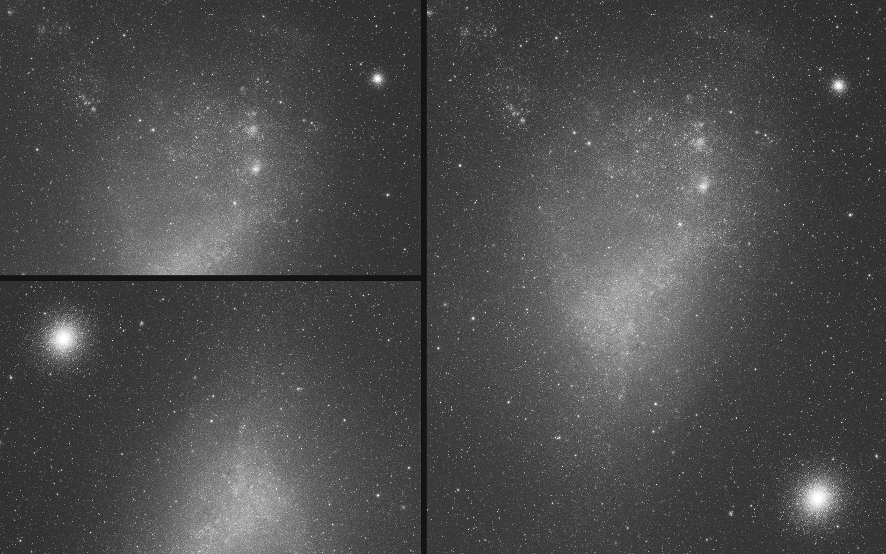

<h1 align="center">OneClick Mosaic &middot; PixInsight</h1>

<p align="center">
  <b>Drop the panels in, press Run, get one finished, cropped mosaic for every filter.</b><br/>
  A self-contained PixInsight script: plate solving check, registration, edge trim, photometric join and a common autocrop,<br/>
  with no other mosaic script required.
</p>

<p align="center">
  
  
  
</p>

---

## Why

Building a multi-filter mosaic by hand means repeating the same sequence for every filter: register the panels on a common
grid, trim the ragged edges, match the brightness of the panels, remove the gradient between them, join them, then crop all the
filters identically. **OneClick Mosaic does this for all your filters in a single run**, with the same geometry for every
filter so that L, R, G, B, Ha, OIII, SII... stack perfectly afterwards.

```
panels ──► astrometry check ──► registration ──► trim ──► photometric join ──► common autocrop ──► Mosaic_<filter>_crop.xisf
           (ImageSolver only                       on one shared TAN grid           same crop, every filter
            if data is missing)
```

## Tutorial

A step-by-step walkthrough with screenshots, from two panels to a finished, plate-solved mosaic, is in
[docs/TUTORIAL.md](docs/TUTORIAL.md). All the images can be downloaded from [docs/tutorial/images](docs/tutorial/images).

<p align="center">
  <a href="docs/TUTORIAL.md"></a><br/>
  <i>Two input panels (left) and the cropped mosaic (right).</i>
</p>

## Features

| | |
|---|---|
| **Inputs** | Files, whole folders or windows already open in PixInsight (open windows are never modified). Automatic grouping by filter (FITS keyword, then file name); reorder panels, move them between filters, rename filters. |
| **Astrometry check** | Each panel is checked for an astrometric solution as soon as it is added. Panels without one are flagged in the list, and on **Run** you are told which panels will be solved and which header items are missing (coordinates, focal length, pixel size). |
| **Plate solving** | Panels without astrometric data open PixInsight's own **ImageSolver** dialog; once solved, the mosaic starts by itself. A *copy* is solved: your original files are never modified. |
| **Shared geometry** | The reference filter (L by default) defines one gnomonic frame, reused by all other filters: same grid, size and orientation. |
| **Photometric join** | Stellar photometry sets the brightness scale between panels; a smoothing thin-plate-spline model removes the residual gradient; the seam is fitted where the data overlap. Grids (rows first) are supported. |
| **Autocrop** | One crop common to all filters: the largest rectangle, rotation optimised, with **no empty pixel**. The cropped mosaics are opened in PixInsight by default. |
| **Robust** | A failing filter does not stop the others; aborting leaves no orphan windows. |
| **Execution** | Sequential (default) or experimental parallel (one extra PixInsight instance per filter). |
| **Housekeeping** | Nothing is saved unless you ask for it; persistent settings; process icon / instance support. |

## How it works, in one paragraph

All panels are reprojected onto a common **gnomonic (TAN)** frame built from their astrometric solutions
(finest pixel scale, orientation of the first panel, size from the union of the projected outlines). Edges are eroded by
5 px. For every pair of overlapping panels the target is scaled to the reference by the **least-squares slope of star fluxes
through the origin** (robust, aperture photometry with a median-sky ring), the remaining additive difference is modelled by
a **thin-plate surface spline** fitted to median-filtered sample squares (smoothing chosen by 5-fold cross-validation), and the
corrected target is composed with the reference along a straight seam through the overlap. Finally one rotated rectangle,
found with a maximal-rectangle-in-a-histogram search over the rotation angle, crops all filters identically.

The full derivation, formulas and parameters are in **[docs/ENGINE.md](docs/ENGINE.md)**.

## Requirements

- PixInsight 1.9.x (developed and tested on 1.9.3.8, Windows).
- *Only for panels without astrometric data:* PixInsight's ImageSolver script (tested with 6.3.1), part of the standard installation.
- Linear panels, with empty areas equal to exactly 0 (the normal output of registration / stacking).

## Install

**Recommended: from PixInsight (updates automatically)**

1. **RESOURCES &gt; Updates &gt; Manage Repositories &gt; Add**, paste:
   ```
   https://raw.githubusercontent.com/RobertPanai/OneClick-Mosaic-PixInsight/main/pixinsight-repository/
   ```
2. **RESOURCES &gt; Updates &gt; Check for Updates**, install *OneClick Mosaic - PixInsight*, restart PixInsight.
   (It installs into `src/scripts/AutoMosaic`; on Windows PixInsight may ask for administrator rights.)
3. Run it from **SCRIPT &gt; Mosaic &gt; AutoMosaic**.

**Manual:** clone or download this repository, then **SCRIPT &gt; Feature Scripts &gt; Add**, select the repository folder
(keep it free of very large files: PixInsight scans it recursively), **Done**.

## Use

1. **Add Files / Add Folder / Add Windows.** Check the filter grouping and the **WCS** column.
2. If a notice says some panels have no astrometric data, tick *Plate solve panels without astrometric data*: the ImageSolver dialog opens on each of them. Set it up and press OK; the mosaic starts by itself.
3. Choose the result: **Open cropped mosaic** (default), *Open uncropped mosaic*, and/or *Save to folder* (cropped / uncropped). *Plate solve the mosaics (ImageSolver)* is on by default: the first mosaic is solved with the ImageSolver dialog and the solution is copied to the other filters. If the solve fails or is cancelled, the mosaic is still delivered and the message says it has no astrometric solution. Press **Run**.

Nothing is saved unless you ask for it. The intermediate files live in a temporary folder that is deleted at the end of the run.
If a step fails, a message box explains what went wrong and what to check.

## Performance

Two panels of 6252 &times; 4176 px, six filters, shared geometry, autocrop, sequential run: **about 2 min 12 s** in total
(17-20 s per filter) on a desktop PC. See [TESTING.md](TESTING.md).

## Limits

Only the TAN projection is produced, the seam is a straight line, and there are no interactive previews. Details in
[docs/ENGINE.md](docs/ENGINE.md#known-limits).

## Repository layout

```
AutoMosaic.js          entry point (PixInsight feature script)
lib/                   dialog, pipeline, runner, inputs, ImageSolver adapter, autocrop
lib/engine/            geometry, reprojection, trim, layout, overlap, photometry, gradient, composition, join
lib/engine/test/       node test of the join planner
docs/ENGINE.md         mathematics and implementation notes
tools/                 builds the PixInsight update repository
pixinsight-repository/ what Manage Repositories reads
```

## Credits and licence

By **Robert Panai**, MIT licence ([LICENSE](LICENSE)); see [CREDITS.md](CREDITS.md). Built on PixInsight, whose ImageSolver
script is used for plate solving.
