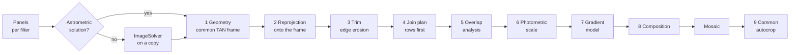

# The mosaic engine: mathematics and implementation

This document explains what `lib/engine/` does, step by step, with the formulas behind it. Everything here is original
code; pixel access, astrometric solutions, interpolation, star detection and the thin-plate surface spline are provided by
PixInsight (PJSR), the rest is implemented in this repository.

Notation: panels are images $I_k(x,y)$ with $x$ to the right and $y$ down (PixInsight convention); $(\alpha,\delta)$ are
right ascension and declination; a pixel is **valid** when it is strictly positive in *all* channels (empty areas of a
registered panel are exactly 0).

---

## 0. Astrometric data check

For every panel the header is inspected without loading pixels (`CTYPE1`, `CRVAL1`, a CD/PC matrix, or PixInsight's
`PCL:AstrometricSolution:*` properties); if the header is inconclusive the image is opened and
`ImageWindow.hasAstrometricSolution` is queried. Panels without a solution are flagged (WCS column, notice under the list).
On *Run* the user is told which panels will be solved and what ImageSolver is missing in the header of each:
approximate coordinates (`RA/DEC` or `OBJCTRA/OBJCTDEC`), focal length $f$ and pixel size $p$. If the header lacks $f$ or $p$
the values typed in the options are used, and the plate scale is

$$ s \;=\; \frac{p}{f}\,\frac{180}{\pi}\cdot 10^{-3} \ \ [\text{deg/px}]\qquad (p\ \text{in}\ \mu\text{m},\ f\ \text{in mm}) $$

(this is $\frac{p}{f}\cdot 206.265$ arcsec/px). Solving is always done on a **copy**; the original file is never modified.

---

## 1. Common geometry (`AM-Geometry.js`)

All panels of all filters are resampled onto one **gnomonic (TAN) frame**.

**Projection.** For a tangent point $(\alpha_0,\delta_0)$:

$$ \cos c = \sin\delta_0\sin\delta + \cos\delta_0\cos\delta\cos(\alpha-\alpha_0) $$

$$ \xi = \frac{\cos\delta\,\sin(\alpha-\alpha_0)}{\cos c},\qquad
   \eta = \frac{\cos\delta_0\sin\delta - \sin\delta_0\cos\delta\cos(\alpha-\alpha_0)}{\cos c} $$

($\xi$ towards the east, $\eta$ towards the north; points with $\cos c\le 10^{-6}$ are rejected). The inverse, with
$\rho=\sqrt{\xi^2+\eta^2}$ and $c=\arctan\rho$, is

$$ \delta = \arcsin\!\Big(\cos c\,\sin\delta_0 + \frac{\eta\sin c\cos\delta_0}{\rho}\Big),\quad
   \alpha = \alpha_0 + \operatorname{atan2}\!\big(\xi\sin c,\ \rho\cos\delta_0\cos c - \eta\sin\delta_0\sin c\big). $$

**Local linearisation of each panel.** With the panel's solution $W_k:(x,y)\mapsto(\alpha,\delta)$ (PixInsight evaluates it,
including any spline distortion) the panel's CD matrix at its centre $(x_c,y_c)$ is obtained by finite differences of the
projected coordinates over one pixel:

$$ \mathrm{CD}_k=\begin{pmatrix}\partial\xi/\partial x & -\partial\xi/\partial y\\ \partial\eta/\partial x & -\partial\eta/\partial y\end{pmatrix},\qquad
   s_k=\sqrt{\lvert\det \mathrm{CD}_k\rvert}$$

(the minus signs convert from image $y$ down to the FITS $y$-up convention). $s_k$ is the plate scale in deg/px, and the
sign of $\det\mathrm{CD}_k$ carries the parity (mirror) of the panel.

**Frame.** The frame uses the *finest* scale and the *orientation (rotation and parity) of the first panel*:

$$ s=\min_k s_k,\qquad \mathrm{CD}=\frac{s}{s_1}\,\mathrm{CD}_1 $$

A pixel offset $(\Delta x,\Delta y_{\text{FITS}})$ from the frame centre corresponds to $(\xi,\eta)^T=\mathrm{CD}\,(\Delta x,\Delta y_{\text{FITS}})^T$, and
conversely $\;(\Delta x,\Delta y_{\text{FITS}})^T=\mathrm{CD}^{-1}(\xi,\eta)^T$.

**Centre and size.** The initial tangent point is the middle of the (RA-unwrapped) $\alpha$ and $\delta$ ranges of the panel
centres. Then, up to 20 times: the outline of every panel is sampled on a $101\times101$ grid, projected on the frame, the union
bounding box $[x_0,x_1]\times[y_0,y_1]$ is formed, and the tangent point is moved to the centre $(m_x,m_y)$ of that box with the
inverse projection, until $\sqrt{m_x^2+m_y^2}<0.5$ px. The frame size is

$$ W=\lceil x_1-x_0\rceil+1,\qquad H=\lceil y_1-y_0\rceil+1 .$$

The resulting *geometry specification* (tangent point, CD, $W$, $H$) is computed on the reference filter and reused for all
other filters ("Shared geometry"), so every mosaic has the same grid, size and orientation.

## 2. Reprojection (`AM-Reproject.js`)

An empty 32-bit frame of $W\times H$ is created with the astrometric solution of §1 written as FITS keywords
(`CTYPE=RA---TAN/DEC--TAN`, `CRVAL`, `CRPIX=(W/2+\tfrac12,\,H/2+\tfrac12)`, `CD`) **and** as the PixInsight properties
`PCL:AstrometricSolution:*` (the properties are what PixInsight uses; keywords alone are not enough). Every panel is then
resampled with PixInsight's `astrometricReprojection`: for each frame pixel $q$,

$$ I'_k(q)=\operatorname{Interp}\big(I_k,\ S_k^{-1}(F(q))\big) $$

where $F$ maps frame pixels to the sky through the TAN solution of the frame and $S_k^{-1}$ maps the sky back to source
pixels through the panel's own solution (so plate distortions are corrected, not only rotation and scale). The interpolation is
PixInsight's automatic mode with a clamping threshold of 0.3 (limits ringing around stars).

## 3. Edge trim (`AM-Trim.js`)

Reprojection leaves soft, anti-aliased and ragged panel edges. Let $V$ be the valid mask. With $N=5$ (default), a pixel
$(x,y)$ is **kept** iff

$$ V(x{-}i,y)\wedge V(x{+}i,y)\wedge V(x,y{-}i)\wedge V(x,y{+}i)\quad\forall\, i\in[0,N] $$

(the image border counts as not valid). This is an erosion by $N$ pixels from each of the four sides computed with run-length
counters in three linear passes (top→bottom for left/right/top, bottom→top for bottom, then zeroing), $O(WH)$.

## 4. Join plan (`AM-Layout.js`)

Each join merges exactly two images (reference, target). For $N$ panels the planner works only from the valid bounding boxes:
panel centres are clustered along each axis (consecutive centres farther apart than half the median size start a new cluster);
rows (or columns) are joined into strips first and the strips are then joined. The reference panel chosen in the dialog
(first by default) is always on the reference side. A join of non-adjacent boxes is refused.
`lib/engine/test/layout.test.js` (run with `node`) checks this logic.

## 5. Overlap analysis (`AM-Overlap.js`)

With valid masks $V_a,V_b$ the overlap is $O=V_a\wedge V_b$ (must contain at least 100 px). Its bounding box
$w\times h$ decides the orientation of the seam: if $h>w$ the panels sit side by side and the seam is a **vertical straight line**,
otherwise horizontal. Per line $t$ along the seam the extent $[p_{\min}(t),p_{\max}(t)]$ of the overlap across the seam is
stored, and the centroids of the reference-only and target-only pixels define on which side the reference lies
($\sigma=\pm1$). The default seam position is the middle of the overlap, $p_0=\tfrac12(p_{lo}+p_{hi})$.

## 6. Photometric scale (`AM-Photometry.js`)

The target must be brought to the reference's flux scale before any gradient is estimated. Stars are used because they are
immune to the gradients (which are additive and smooth) and to differences in sky level.

1. Stars are detected in both panels inside the overlap bounding box with PixInsight's `StarDetector`.
2. Stars are matched by position: nearest neighbour within 3 px (grid hashing, $O(n)$).
3. Square-aperture photometry on each matched pair, per channel: half-width
   $h=\operatorname{clamp}(\lceil\sqrt{\text{size}}/2\rceil+2,\,3,\,20)$, a guard gap of 2 px and a background ring 4 px wide
   whose **median** $b$ is the local sky. The flux is $F=\sum_{\text{aperture}} I - b\,N_{\text{aperture}}$. Pairs touching
   empty pixels, or with a peak above 70 % of the image maximum (non-linear / saturated), are discarded.
4. The scale is the least-squares slope **through the origin** of reference flux versus target flux:

$$ s=\arg\min_s\sum_i (F^{a}_i - s\,F^{b}_i)^2=\frac{\sum_i F^a_iF^b_i}{\sum_i (F^b_i)^2} $$

   Robustness: start from the median ratio $m$ of $F^a_i/F^b_i$, drop pairs whose ratio is outside $[m/1.5,\,1.5\,m]$, then
   iterate the fit three times removing the 2 % of pairs with the largest relative residual $|F^a_i-sF^b_i|/F^a_i$
   (at least 12 stars are kept), and a final fit.
5. If fewer than 12 usable stars exist, the fallback is the ratio of the medians of the overlap. A scale outside $(0.2,5)$
   aborts with an explanatory message (the panels are probably not linear or do not overlap).

After this step the residual difference $D=I_a-s\,I_b$ in the overlap is, to first order, an **additive gradient** (scattered
light, sky glow, flat-field residuals) plus noise.

## 7. Gradient model (`AM-Gradient.js`)

**Samples.** The overlap bounding box is tiled with squares of side $g=\max\!\big(16,\lceil\sqrt{\text{area}/1200}\rceil\big)$
(about 1200 samples). The value of a square is the **median** of $D$ over its pixels, only if every pixel is valid in both
panels. The median makes each sample insensitive to stars inside the square.

**Star rejection.** The brightest 3 % of the detected stars (at least 5, at most 400) define circles of radius
$r_i=\sqrt{\text{size}_i}/2+1$. A sample whose centre lies within $\kappa\,r_i+g/2$ of a star is removed, with $\kappa=1.5$
for the *overlap model* (keeps local detail such as halos) and $\kappa=6$ for the *target model* (only the large-scale trend).

**Thin-plate spline.** Each model is a smoothing thin-plate surface spline (PixInsight `SurfaceSpline`) fitted to the
samples $z_j$ at $(x_j,y_j)$ in coordinates normalised by $L=\max(\text{bbox width},\text{bbox height})$:

$$ \min_f\ \sum_j\big(f(x_j,y_j)-z_j\big)^2+\lambda\iint\big(f_{xx}^2+2f_{xy}^2+f_{yy}^2\big)\,dx\,dy $$

**Choice of the smoothing $\lambda$** for the overlap model: 5-fold cross-validation over
$\lambda\in\{10^{-7},\dots,10^{-1}\}$ minimising the mean absolute prediction error on the held-out samples (below 30 samples
a default of $10^{-3}$ is used). The target model uses $\lambda_T=\min(1,\,1000\,\lambda)$, i.e. it is far smoother.
Spline values are clamped to the sample range extended by 25 % to prevent wild extrapolation. The overlap model is tabulated on
an 8 px grid and evaluated by bilinear interpolation.

**Extension outside the overlap.** A target-only pixel at line $t$ along the seam and at distance $q$ beyond the nearest overlap
edge receives the correction

$$ g(t,q)=T(t)+\big(O(t)-T(t)\big)\max\!\Big(0,\,1-\frac{q}{400}\Big) $$

with $O(t)$ and $T(t)$ the overlap and target model values on that edge pixel. Only the component *parallel to the seam* is
extrapolated (it is constant perpendicular to the seam), and the detailed overlap model fades into the smooth trend over 400 px.
This avoids inventing structure far from where the two panels were actually compared.

## 8. Composition (`AM-Combine.js`)

For every pixel of the frame, with $T'=s\,I_b+g$ the corrected target and $u=\sigma\,(p-p_0)$ the signed distance to the seam
(positive on the reference side):

| Pixel | Output |
|---|---|
| valid only in $a$ | $I_a$ |
| valid only in $b$ | $\max(s\,I_b+g(t,q),\ \varepsilon)$ with $\varepsilon=10^{-7}$ (never exactly 0, which means "empty") |
| overlap, $u\le0$ | $T'$ (target side of the seam) |
| overlap, $u>0$, mode **Overlay** (default) | $I_a$ |
| overlap, $0<u<R_w$, mode **Average** | $(1-w)\,I_a+w\,T'$ with $w=1-u/R_w$ |
| overlap, $0<u<R_w$, mode **Blend** | $T'$ with probability $w$, otherwise $I_a$ (position-hash dither) |

$R_w$ is the blending width, 90 % of the reference side of the overlap by default. In Overlay mode the seam is a hard
switch; because the scale and gradient have just been fitted on exactly this overlap, the expected jump across the seam is the
noise of the difference only. The module also reports the residual statistics in the overlap (mean, RMS and a MAD-based noise
$1.4826\,\operatorname{med}|d-\operatorname{med}d|$ of $I_a-T'$) in the log. The result inherits the reference's header and
astrometric solution. For $N>2$ panels the partial mosaics are folded following the plan of §4.

## 9. Common autocrop (`AM-Crop.js`)

All mosaics share one grid, so **one** rectangle is computed from the intersection of the valid areas of every filter and applied
identically to each of them (sizes and star positions stay identical).

1. Valid mask: $>0$ in every channel; fine mask at 1/2 resolution and coarse mask at 1/8, both with *minimum pooling*
   (conservative); the fine mask is eroded by a 4 px safety margin; enclosed holes of the coarse mask are filled.
2. For each trial angle $\theta$ the mask is resampled in the rotated frame and the largest all-valid axis-aligned rectangle is
   found with the **maximal-rectangle-in-a-histogram** algorithm (stack-based, $O(\text{pixels})$ per angle): coarse scan at 1/16
   resolution in 1° steps, then refinement at 1/8 resolution in 0.1° steps.
3. Exact refinement on the fine mask: each side is pushed outwards while the rectangle *boundary* stays on valid pixels (the
   valid region has no holes, so a valid boundary implies a valid interior), then the angle is fine-tuned.
4. A rotation is used only if it keeps at least 0.5 % more image than the best axis-aligned crop (otherwise no resampling takes
   place). The crop is applied with DynamicCrop (Lanczos) and verified: no empty pixel on the border of any result.

---

## Complexity and memory

Every stage streams the images line by line (`getSamples`/`setSamples` on one row per channel); the spline works on about
1200 samples. Cost is dominated by the reprojection and by $O(WH)$ passes; a 2-panel mosaic of $6250\times4180$ px takes about
20 s per filter on a desktop PC.

## Known limits

- Only the TAN projection is produced; very wide mosaics are distorted at the edges.
- The join line is straight (perpendicular to the shorter direction of the overlap); there is no free-form seam.
- Panels must be linear and have non-zero background up to their edges (empty = exactly 0).
- No interactive preview dialogs; no "outlier %" option for the photometric fit beyond the fixed 2 %.
