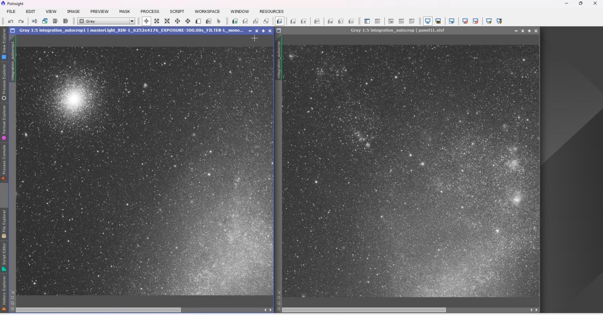
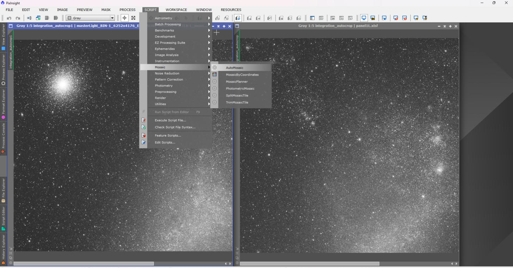
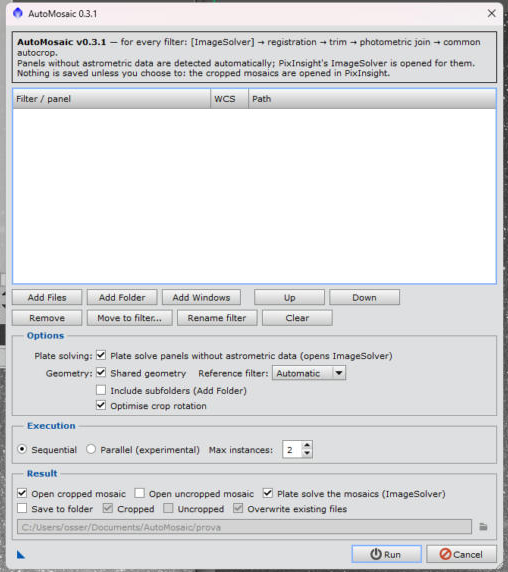
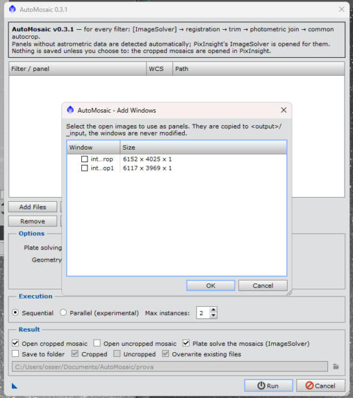
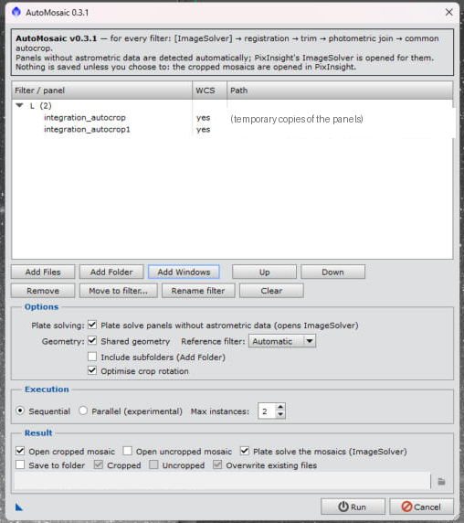
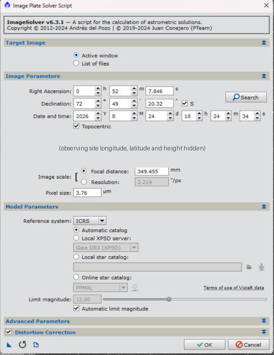
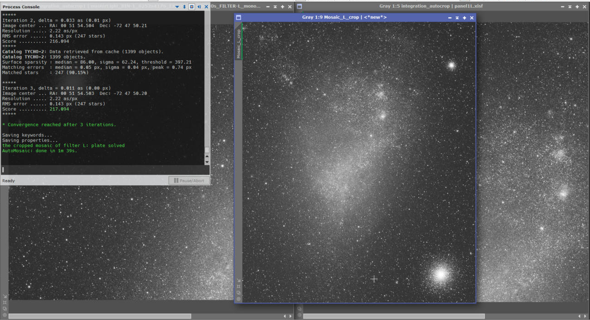
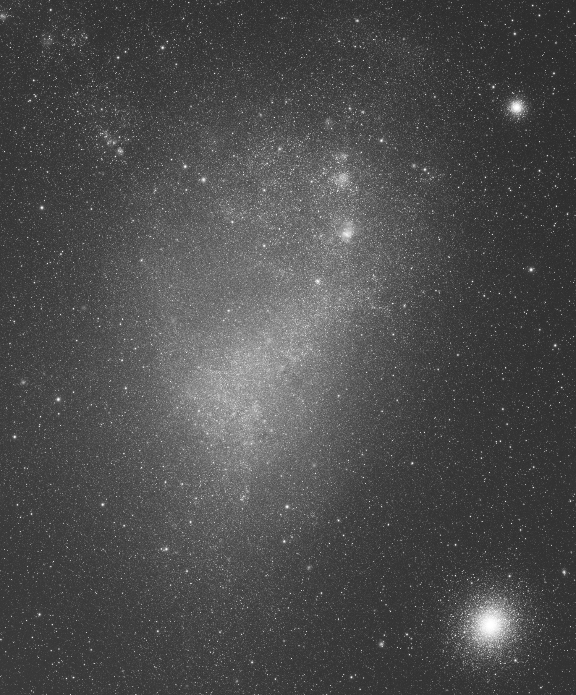
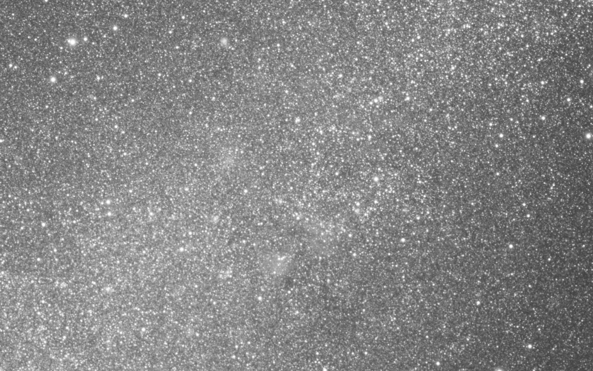
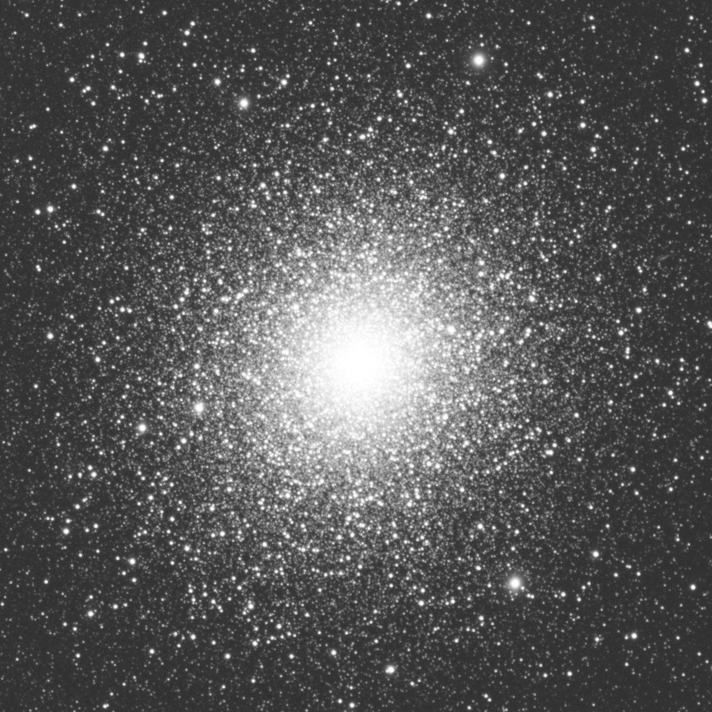

# Tutorial: from two panels to one finished mosaic

This walkthrough follows a real run: two luminance (L) panels of the Small Magellanic Cloud, joined into one cropped,
plate-solved mosaic. Every image on this page can be downloaded: click it on GitHub and use the download button, or take the
files from [`docs/tutorial/images`](tutorial/images).


*Left: the two input panels (6152 x 4025 px and 6117 x 3969 px). Right: the cropped mosaic (6032 x 7277 px). Same
PixInsight Auto STF on every image; the data are not stretched.*

## 1. Open the panels

Open the panels in PixInsight (or keep the files on disk: **Add Files** and **Add Folder** work as well). Here the two panels
are already open as image windows. They keep their astrometric solution, so no plate solving is needed for them.



## 2. Start the script

**SCRIPT > Mosaic > AutoMosaic**.



The dialog opens empty. The *Result* section at the bottom decides what you get back:

- **Open cropped mosaic**: on by default.
- **Open uncropped mosaic**: optional.
- **Plate solve the mosaics (ImageSolver)**: on by default; turn it off if you do not want the mosaics solved.
- **Save to folder**: off by default. Nothing is written to disk unless you ask for it.



## 3. Add the panels

Press **Add Windows**, tick the open images to use as panels and confirm. The windows are never modified: copies are used.



The panels are grouped by the filter found in their headers (here *L (2)*). The **WCS** column tells you whether a panel
already has an astrometric solution. A panel without one is solved with PixInsight's ImageSolver before the mosaic starts.



## 4. Run

Press **Run**. The panels are registered on one shared grid, the ragged edges are trimmed, the brightness of the panels is
matched with stellar photometry, the gradient between them is removed, and the join is fitted where the data overlap. A common
autocrop is then applied. For this pair the whole pipeline took 23 seconds.

## 5. Plate solve the mosaic

Cropping removes the astrometric solution, so the cropped mosaic is solved with PixInsight's own **ImageSolver** dialog,
opened with your saved settings. Check the values and press **OK**.



The solve is done once per kind of mosaic (cropped, uncropped), and the solution is copied to the other filters, which share
the same grid and crop. In this run ImageSolver converged after three iterations:

```
Image center ... RA: 00 51 54.503  Dec: -72 47 50.20
Resolution ..... 2.22 as/px
RMS error ...... 0.143 px (247 stars)
the cropped mosaic of filter L: plate solved
AutoMosaic: done in 1m 39s.
```

If the solve fails or is cancelled, the mosaic is still delivered and a message tells you that it has no astrometric
solution.

## 6. The result

The cropped mosaic is opened in PixInsight with PixInsight's Auto STF applied as the screen stretch (shadows clipping
-2.8 sigma, target background 0.25). Only the screen transfer function is set: the pixels are untouched.





Larger version for download: [`mosaic_L_crop_large.png`](tutorial/images/mosaic_L_crop_large.png) (3016 x 3638 px).

### Looking at the join

The two panels overlap by about 870 px. This is the region of the mosaic where they meet, at 100% (1600 x 1000 px). There is
no visible seam, no step in brightness and no gradient.



A 100% crop of the globular cluster in the lower right corner shows that the registration did not blur the stars:



## All images

| Image | Content |
|---|---|
| [`overview_panels_to_mosaic.png`](tutorial/images/overview_panels_to_mosaic.png) | Panels and mosaic side by side |
| [`panel1_L.png`](tutorial/images/panel1_L.png), [`panel2_L.png`](tutorial/images/panel2_L.png) | The two input panels |
| [`mosaic_L_crop.png`](tutorial/images/mosaic_L_crop.png), [`mosaic_L_crop_large.png`](tutorial/images/mosaic_L_crop_large.png) | The cropped mosaic |
| [`detail_center_100pct.png`](tutorial/images/detail_center_100pct.png), [`detail_cluster_100pct.png`](tutorial/images/detail_cluster_100pct.png) | 100% crops |
| `01_...` to `07_...` | Screenshots of the steps above |

The screenshots were taken with a pre-release build, so the version number in the window title may differ from the release you
have installed. In the ImageSolver screenshot the observing site coordinates are hidden on purpose.
